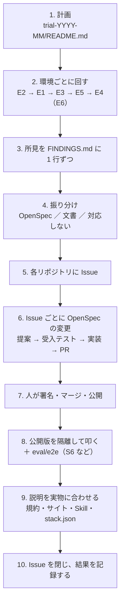

# 試用の進め方 — 版が大きく上がったときに、PDF Agent Stack を通しで使う

PDF Agent Stack の MCP 4 本・Skill 3 本・plugin を、利用者と同じ経路で通しに使い、各リポジトリの単体テストと A/B では見えない問題を見つけて直すための手順です。2026-11 の試用（[`trial-2026-11/`](trial-2026-11/)、[#47](https://github.com/shuji-bonji/pdf-agent-stack/issues/47)・[#48](https://github.com/shuji-bonji/pdf-agent-stack/issues/48)）で実際に回した進め方と、そこで分かったことをまとめています。

## いつ回すか

次のどれかに当たったら、試用を計画します。

- メジャーアップデート、または複数のパッケージで minor が 3 つ以上進んだ
- 依存の入れ替え（2026-11 の前は pdf-lib の撤去）や、暗号化・エラーの形など family 全体に関わる振る舞いの変更が入った
- 開発の進め方を変えた（2026-11 の前は OpenSpec の導入）
- 新しいホスト（Codex・Gemini CLI など）や新しい OS で使えるようにしたい

前回の試用からの版の差を、計画の冒頭に表で書きます（`stack.json` の `published` から拾える）。

## 全体の流れ

## 1. 計画

`eval/trial-YYYY-MM/README.md` を作り、追跡用の Issue を立てます。書くことは次のとおりです（2026-11 の [README](trial-2026-11/README.md) がそのまま雛形になります）。

- なぜ今やるか（前回からの版の差）
- 3 つの軸と環境の表（下の「環境」）
- 優先して確かめること（下の「呼んでいない側を優先する」）
- 検体の作り方
- 記録の書式と、完了の条件

## 2. 環境

原因を切り分けられるように、環境を 3 つの軸に分けます。

| 軸 | 何が違うか |
| --- | --- |
| A. 配布の形 | 手元のビルド（dev）／npm の公開版（npx）／plugin 経由 |
| B. OS・ランタイム | macOS／Linux／Windows、Node の版、Java（veraPDF） |
| C. ホスト | Claude Code・Claude のアプリ／Grok Build など |

| ID | 環境 | 回すもの | 担当 |
| --- | --- | --- | --- |
| E2 | Linux・npm の公開版。**基準** | 全ツール ＋ `eval/e2e` | Claude（クラウドのコンテナ） |
| E1 | Mac・手元のビルド（`pdf-*-local`） | 全ツール。E2 との突き合わせ | Claude（手元に登録した MCP） |
| E3 | Mac・Claude の plugin | Skill 3 本、UC01〜UC10 | Claude |
| E4 | Mac・別のホスト（2026-11 は Grok Build） | UC01〜UC10 | 本人 |
| E5 | GitHub Actions の ubuntu / macos / windows | `eval/e2e` を OS の行列で（`e2e-os-matrix.yml`、手動） | Claude がワークフローを書き、本人が回す |
| E6 | Windows・ホスト | plugin の登録、パスと環境変数、UC を数本 | **保留**（Windows の実機が手に入るまで。検討して採らなかった方法は [2026-11 の README](trial-2026-11/README.md) の「E6 を保留にした理由」） |

E1 と E2 の結果が一致すれば、パッケージは配布の形に左右されません。E3 と E4 で結果が分かれれば、原因はホストの側にあります。

## 3. 呼んでいない側を優先する

単体テストと A/B は「前の版と同じか」しか見ません。次の側は、通しで使わないと見えません。

| 側 | 2026-11 に見つかったもの |
| --- | --- |
| エラーの経路（存在しないパス・0 バイト・PDF でない・途中で切れた・知らない引数） | 4 サーバーでエラーの形とコードが 4 通りに割れていた（→ #48）。0 バイトのファイルで reader の 9 ツールが `INTERNAL_ERROR` |
| 鍵を導けない暗号化 PDF | 「読めなかった」を「タグが無い」「XMP が無い」「署名が無い」と答える（reader#39・verify#31） |
| 外部からの取得（`read_url`）のネットワークの失敗 | 接続拒否・名前解決・時間切れ・TLS がすべて `INTERNAL_ERROR`（reader#46） |
| PDF 2.0 の出力を読み戻す | `/Info` の無い文書で題名・日付が `null`（reader#42） |
| markdown の本文を人が読む | A/B は JSON しか比べていなかった |
| 同じツールを順番を変えて何度も呼ぶ | 2026-11 は該当なし。pdf-spec-mcp 0.4.0 はこれでしか出なかった |
| Windows の書き方のパス | E5 で確かめる |

## 4. 所見と振り分け

所見は `trial-YYYY-MM/FINDINGS.md` に 1 行ずつ、ID・環境・対象（パッケージと版・ツール）・入力・想定・実際（応答を引用）・振り分け・Issue の列で書きます。振り分けは次の 3 つです。

- **OpenSpec**：各リポジトリの Issue にし、OpenSpec の変更として直す
- **文書**：README・サイト・Skill の記述を直す
- **対応しない**：理由を書いて閉じる

同じ形の所見が複数のサーバーにまたがるときは、横断の Issue を pdf-agent-stack に立て（2026-11 は #48 のエラーの契約）、各リポジトリの Issue をそこから参照します。

## 5. Issue ごとに直す

各リポジトリの [AGENTS.md](https://github.com/shuji-bonji/pdf-reader-mcp/blob/main/AGENTS.md) の決まりに従います。

1. **方針を先に決める。** 応答の形が変わるもの・選択肢が複数あるものは、提案を書く前に本人に選んでもらう（2026-11 は reader の 4 件をまとめて質問した）
2. **提案**を `openspec/changes/<slug>/` に出して commit する。ISO の条文は pdf-spec-mcp で引いて確かめる
3. **受入テストを先に書き、変更前のコードで落ちることを確かめる。** 作った文ではなく実物で確かめる（`read_url` は 127.0.0.1 に立てたサーバーと実際の証明書で起こした）
4. **実装**し、CI の検査一覧をそのまま回して終了コードで判定する。`tools/list` を変更前後の `dist` で比べる
5. **PR** を作り、各 Issue に直した内容をコメントする
6. 人が `approved`・`pr` を書き、`tasks.md` の 4.x にチェックを入れてから `npx openspec archive <slug> --yes`、署名・マージ・公開

## 6. 公開した後に確かめる

- **npm の公開版を隔離した場所に入れて、stdio で起動して叩く**（`npm init -y` した空のフォルダーに `npm i <pkg>@<版>`）。直した振る舞いを 1 つずつ見る
- **`eval/e2e` を公開版で回す**（`npm run setup` が `stack.json` の版を入れる）。S6（エラーの契約）は、足したケースが直す前の版で落ちることも確かめる（`PDF_E2E_<KEY>_DIR` で古い版に向ける）
- npm の `latest`・MCP Registry の `isLatest`・タグ・`stack.json` の版がそろっているか
- 規約（docs `specs/06`）・サイト・Skill の説明を、実物の振り分けに合わせる

## 2026-11 に分かったこと（次の試用で同じところを踏まないために）

### 計器と記録

- **Issue の再現手順の値を、そのまま受入テストに使わない。** reader#46 の「接続を拒まれる」例のポート 9 は Fetch Standard が接続を断るポート（bad port）で、接続拒否の経路を一度も通っていなかった
- **WebFetch は公開したページを古いキャッシュで返すことがある。** サイトの公開を確かめるときは、キャッシュを避ける付加文字列を付けて直接取る
- 旧版の規約 §2.3（入れ子のエラーの形）を実装していたサーバーは 0 だった。規約は実物を測ってから書き、書いたら S6 のような契約テストで 4 サーバーを同時に測る

### OpenSpec と spec-ids

- **新しい capability を作る変更では、`archive` が差分の front matter を正本へ写さない**（OpenSpec 1.14.1）。archive の後に `spec_id`・`kind`・`introduced_by` を足す。MODIFIED・REMOVED だけの変更では残る
- **spec-ids は、提案中の変更の `REMOVED` を数えない。** archive の前は、正本に残っている要件に「テストに無い ID」と言って `spec-ids check` が落ちる。archive すれば通る
- **archive の後に、エディタで開いたままの `tasks.md` を保存すると、元の場所に `tasks.md` だけが作り直される。** 4.x のチェックは archive の前に入れる
- 1 本の PR で提案から archive まで進める形では、archive の前は `spec-gate` の `pr-scope` が落ちる（既知の形）

### git と分担

- **main の commit を署名し直して push すると、その上に作った PR のブランチが衝突する。** PR のブランチは、本人が署名して push した後の main から切る。衝突したら、自分の commit だけを `git rebase --onto origin/main <古い commit>` で載せ直す
- 浅く複製したリポジトリでは、push したブランチの追跡の設定が無いので「push していない」と見える。fetch の refspec を足して追跡を設定する

### ライブラリの振る舞い

- Node の `fetch` は失敗の種類にかかわらず `TypeError: fetch failed` を投げ、理由は `error.cause.code` にしか無い。時間切れは名前が `TimeoutError`
- 名前違いの証明書は、CA を信頼させないと名前の検査まで進まない（`NODE_EXTRA_CA_CERTS` は起動時にしか読まれない）
- pdf.js の `getMetadata().metadata` は `rdf:Alt` を区切りなしでつなぎ、属性の形の XMP を読まない
