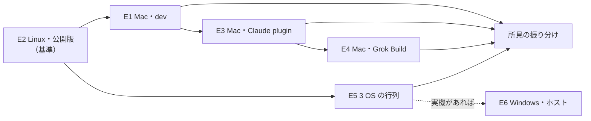

# 2026-11 試用 — 環境を変えて PDF Agent Stack を通しで使う

PDF Agent Stack の MCP 4 本・Skill 3 本・plugin を、配布の形・OS・ホストを変えて使い、問題を見つけるための計画です。作成日は 2026-11-03 JST です。追跡用の Issue は [#47](https://github.com/shuji-bonji/pdf-agent-stack/issues/47) です。

## なぜ今やるか

前回の通し実走（2026-08-24）と Grok Build での評価（2026-09-15〜16、[`hosts/grok-build/`](../hosts/grok-build/)）の後で、各パッケージの版が大きく上がりました。

| パッケージ | Grok Build 評価の時点 | 2026-11-03（`stack.json`） |
| --- | --- | --- |
| pdf-spec-mcp | 0.6.0 | 0.11.0 |
| pdf-reader-mcp | 0.15.1 | 0.18.1 |
| pdf-verify-mcp | 0.26.1 | 0.32.2 |
| pdf-writer-mcp | 0.21.1 | 0.23.1 |
| pdf-constraints | 0.6.1 | 0.7.2 |

normativepdf は 0.9.1 で、依存する 5 パッケージ（recover・pdf-constraints・verify・reader・writer）が同じ版を使っています。2026-08-24 の通し実走では、依存する版が 3 通りに割れていました。

この間に、pdf-lib の撤去、暗号化 PDF の扱いの変更、OpenSpec の導入が入りました。各リポジトリの単体テストと A/B は通っていますが、利用者と同じ経路で通しに使ったことはまだありません。

見つかった問題は、OpenSpec の変更として 1 件ずつ直します。

## 3 つの軸

問題が出たときに原因を切り分けられるように、環境を 3 つの軸に分けます。

| 軸 | 何が違うか | 過去に起きたこと |
| --- | --- | --- |
| A. 配布の形 | 手元のビルド（dev）／npm の公開版（npx）／plugin 経由 | pdf-spec-mcp 0.4.0 は単体テストと e2e がすべて通っていたが、公開版を npx で起動して同じ節を 2 回引いたとき、表の行が増えていた |
| B. OS・ランタイム | macOS／Linux／Windows、Node の版、Java（veraPDF） | macOS 用の `node_modules` が Linux で動かない。pdfjs + `@napi-rs/canvas` が画像ページで segfault した |
| C. ホスト（MCP を起動する側） | Claude Code・Claude Desktop／Grok Build | plugin.json の `env` に書いた `${VAR}` を、Claude Code のターミナルは展開する（pdf-spec-mcp の README）。デスクトップアプリで「このコンピュータにリンク」したクラウドセッションと Grok は展開しない。Grok は `~/.grok/config.toml` に書けば展開する |

## 環境と担当

| ID | 環境 | 軸 A / B / C | 回すもの | 担当 |
| --- | --- | --- | --- | --- |
| E1 | Mac・手元のビルド（`pdf-*-local` として登録した MCP） | dev / macOS / Claude | 層 1（全ツール）。E2 と結果が同じかを突き合わせる | Claude（手元に登録された MCP を呼ぶ） |
| E2 | Linux・npm の公開版 | npx / Linux / なし（SDK のクライアント） | 層 1（全ツール）＋ `eval/e2e`。**ここを基準にする** | Claude（クラウドのコンテナ） |
| E3 | Mac・Claude の plugin | plugin / macOS / Claude | 層 2（Skill）・層 3（連携。UC01〜UC10） | Claude（plugin の MCP と pdf-specialist subagent） |
| E4 | Mac・Grok Build | plugin / macOS / Grok | 層 3（UC01〜UC10）。E1〜E3 で見つけたものの再確認 | shuji-bonji |
| E5 | GitHub Actions の ubuntu / macos / windows（x64）。Windows の ARM64 ランナーが使えれば足す | npx / 3 OS / なし | `eval/e2e` を OS の行列で回す（起動・`tools/list`・シナリオ S1〜S5） | Claude がワークフローを書き、shuji-bonji が push |
| E6 | Windows・ホスト（Claude Desktop など） | plugin / Windows / Claude | plugin の登録、パスと環境変数の渡し方、UC を数本 | **保留**（Windows の実機が手に入るまで。理由は下記） |

### E6 を保留にした理由（2026-11-03）

次の方法を検討しましたが、どれも採りませんでした。

| 方法 | 採らなかった理由 |
| --- | --- |
| UTM + Windows 11 ARM（Microsoft 公式の Arm 版 ISO） | 認証しないまま使うことになり、使用許諾の条件を満たさない。CPU も利用者の多くが使う x64 と違う |
| Amazon WorkSpaces | ライセンス込みのバンドルは Windows 11 クライアントではない。Windows 11 を持ち込むには 1 リージョンで月 50 台以上と専用ハードウェアが要る |
| Microsoft の評価用仮想マシン | ARM 版が無く、配布されている版は 2024-07-15 で期限が切れている |
| 手持ちの Microsoft 365 Business Basic | Windows のライセンスを含まない |

パッケージが Windows で動くかどうかは E5 で確かめます。ホストへの登録（パスと環境変数の渡し方など）は、実機が手に入ってから E6 で確かめます。

E1 と E2 の結果が一致すれば、パッケージ自体は配布の形に左右されないと言えます。E3 と E4 で結果が分かれれば、原因はホストの側にあります。

## 試用の層

### 層 1：MCP 単体

全ツールを呼びます。これまでの A/B と e2e で呼んでいない側を優先します。

| 呼んでいない側 | 理由 |
| --- | --- |
| markdown の本文を人が読むこと | A/B は前の版と同じかどうかしか見ない。verify 0.20.0〜0.22.0 では markdown に同じ見出しが 2 行並んでいたが、A/B は 3 回とも「差 0 件」で、見つけたのは公開版の本文を読んだときだった |
| 同じツールを、順番を変えて何度も呼ぶこと | 単体テストは各ツールを 1 回ずつしか呼ばない。pdf-spec-mcp 0.4.0 の不具合は 2 回目の呼び出しで出た |
| PDF 1.7 の文書と `spec: "pdf17"` | 利用者は 2.0 より 1.7 のほうが多い。これまで 2.0 を基準に作ってきた |
| 署名の無い暗号化 PDF | writer の `ENCRYPTED_PDF` は、Grok Build での評価でも一度も返っていない（検体の官報は署名付きで、`SIGNED_PDF` が先に返る） |
| パスワード付きの暗号化 PDF（鍵を導けないもの） | writer 0.23.0 まで `INVALID_PDF` を返していた（0.23.1 で修正） |
| エラーの経路 | 存在しないパス、壊れた PDF、知らない引数、空のファイル |
| Windows の書き方のパス | `C:\...`、バックスラッシュ、空白を含むパス（E5・E6） |

### 層 2：Skill 単体

pdf-read・pdf-trust・pdf-publish の手順書の記述が、いまのツールの応答と合っているかを確かめます。2026-08-24 の通し実走では、pdf-publish の記述が writer 0.17.0 の時点のままでした。各 Report（Read / Trust / Publish）が、読めなかった範囲と実施しなかった検査を書いているかも見ます。

### 層 3：連携

[`hosts/grok-build/instructions/`](../hosts/grok-build/instructions/) の UC01〜UC10 を、同じ指示書・同じ検体で回します。採点の物差しも [`00-evaluation-criteria.md`](../hosts/grok-build/00-evaluation-criteria.md) をそのまま使います（4 段階の評価、境界違反の 6 項目、想定と実際の 4 列の表）。

あわせて、前回までに見つかった次のものが今の版で残っていないかを確かめます。

- 2026-08-24 の通し実走で見つかった 6 件（`evaluate_policy` が trust anchor の読み込み失敗を「anchor が無い」と報告する、暗号化 PDF の扱いがツールごとに違う、など）
- Grok Build での評価の改善点（`create_markdown_pdf` の H1 の二重は writer 0.23.0 の `drawTitle` で対応済み。その後の挙動を確かめる）

## 検体

- 公開できる検体は [`hosts/grok-build/fixtures/`](../hosts/grok-build/fixtures/) を使います。
- 署名の無い暗号化 PDF と、パスワード付きの暗号化 PDF は新しく作ります。作り方（normativepdf の `encryptPdf`、または qpdf）と、空のユーザーパスワード・パスワード付き・RC4・AES の別を記録します。
- 官報 PDF は同梱しません。入手先は [`00-grok-build-setup.md`](../hosts/grok-build/00-grok-build-setup.md) に書いてあります。

## 記録の書式

各環境の結果は `trial-2026-11/<環境 ID>/` に置きます（例: `trial-2026-11/E3/UC01.md`）。UC の報告書は [`00-report-template.md`](../hosts/grok-build/00-report-template.md) を使い、先頭に環境 ID と実際に起動した版を書きます。

見つけた問題は、`trial-2026-11/FINDINGS.md` に 1 行ずつ書きます。

| 列 | 書くこと |
| --- | --- |
| ID | `F-01` から順に |
| 環境 | どの環境で出たか（E1〜E6）。他の環境で出なかったことも書く |
| 対象 | パッケージ名と版、ツール名 |
| 入力 | ツール名と主な引数、検体 |
| 想定 | 返るはずのフィールドと値 |
| 実際 | 返ったフィールドと値（応答を引用する） |
| 振り分け | OpenSpec の変更にする／文書・Skill の修正で済ませる／対応しない（理由） |
| Issue | 起票した先の Issue |

## 進め方と完了の条件

1. E2（基準）→ E1 → E3 の順に Claude が回し、所見を `FINDINGS.md` に書く
2. E5 のワークフロー（`eval/e2e` を 3 OS で回す）を作る
3. E4 を shuji-bonji が回す。手順は [`hosts/grok-build/`](../hosts/grok-build/) のとおりで、版だけ今のものにする
4. 所見を振り分け、OpenSpec の変更にするものは各リポジトリに Issue を立てる

完了の条件は次のとおりです。

- E1〜E5 の結果がそろっている（実施しなかったものは理由を書く）
- `FINDINGS.md` のすべての行に振り分けがある
- E6 は、実機が用意できなければ「保留」と理由を書いて閉じる

## 結果（2026-11-05 に閉じた）

E1〜E5 を回し、所見 33 件（F-01〜F-33）をすべて振り分けました。追跡用の [#47](https://github.com/shuji-bonji/pdf-agent-stack/issues/47) と、エラーの契約をそろえた [#48](https://github.com/shuji-bonji/pdf-agent-stack/issues/48) を 2026-11-05 に閉じました。進め方と分かったことは [`../TRIAL-PLAYBOOK.md`](../TRIAL-PLAYBOOK.md) にまとめてあり、次の試用はそれに沿って計画します。

### 直して公開したもの

| パッケージ | 版 | 閉じた Issue |
| --- | --- | --- |
| pdf-reader-mcp | 0.19.0・0.20.0・0.20.1 | #39・#40・#41・#42・#43・#44・#46 |
| pdf-writer-mcp | 0.23.3 | #13・#14 |
| pdf-verify-mcp | 0.33.0・0.34.0 | #32・#35 |
| pdf-spec-mcp | 0.12.0・0.13.0 | #33 |
| pdf-publish Skill | 0.7.2 | — |

エラーの応答は 4 サーバーとも family の形（docs `specs/06` §2.3）にそろい、S6（`e2e/tests/s6-error-contract.test.mjs`）が公開版の 4 サーバーで 23 件すべて通ります（2026-11-05、reader 0.20.1・writer 0.23.3・verify 0.34.0・spec 0.13.0）。

### 残っているもの

| もの | 状態 |
| --- | --- |
| E6 Windows・ホスト | **保留**。Windows の実機を手に入れる目処が立っていないので、当分は実施しない |
| S6 の `read_url` の 5 件を macOS・Windows で回す | 未実施。Linux でだけ確かめた。E5 の行列（`e2e-os-matrix.yml`、GitHub Actions のランナー）で回せる |
| 所見から起票した Issue のうち直していないもの | pdf-writer-mcp#9・#10・#11・#12、pdf-verify-mcp#31・#33・#34、pdf-spec-mcp#32 |
