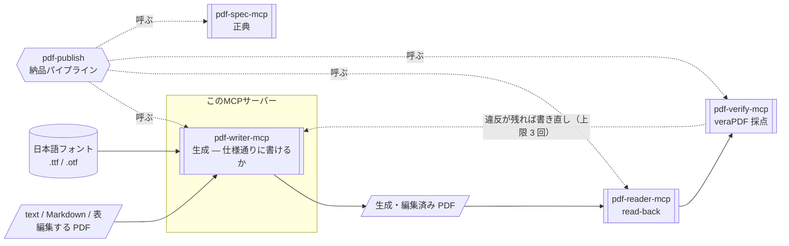
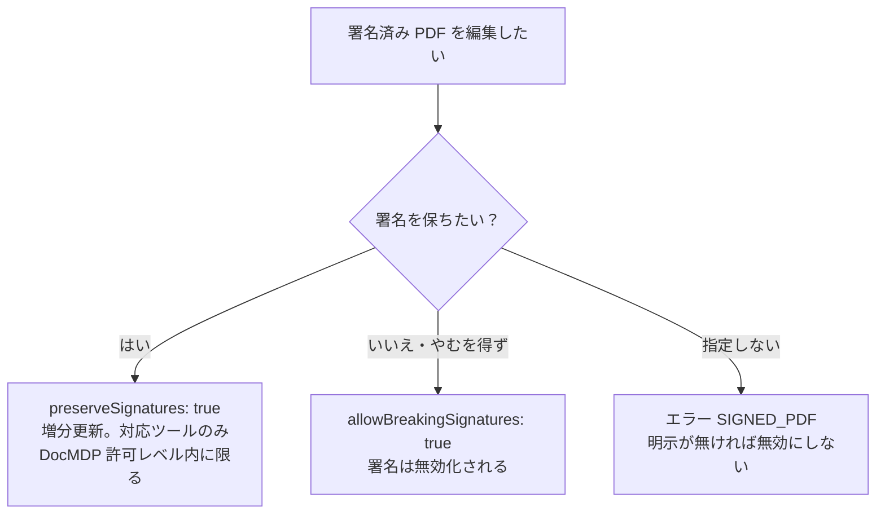

# pdf-writer-mcp

**PDF を作る・編集するサーバーです。** テキスト・Markdown・表から PDF を生成し、ページ操作（結合・分割・並べ替え）、しおり・注釈・透かし・ページ番号の付与、フォーム記入、ファイル添付ができます。日本語フォントの埋め込み（サブセット化）に対応しています。

- npm: [`@shuji-bonji/pdf-writer-mcp`](https://www.npmjs.com/package/@shuji-bonji/pdf-writer-mcp) / 現行 v0.28.1 / [GitHub](https://github.com/shuji-bonji/pdf-writer-mcp)
- このページは責務と使いどころの解説です。全ツールの引数・戻り値は[ツールリファレンス](/ja/reference/mcp/pdf-writer)（`tools/list` から自動生成）へ
- 内部実装は [normativepdf](https://github.com/shuji-bonji/normativepdf)（振る舞いを ISO 32000 の条項に紐づけた PDF ライブラリ）。日本語フォント埋め込みは harfbuzz サブセットで行う

## これ 1 台でできること

「この内容で請求書 PDF を作って」「この 3 つの PDF をまとめて」「全ページに社外秘の透かしを入れて」といった作成・編集はここで完結します。スクリーンリーダーで読めるタグ付き PDF（PDF 1.7 では PDF/UA-1、PDF 2.0 では PDF/UA-2）の生成にも対応しており、AI に文書を作らせてそのまま納品する用途に向きます。

## Skill 連携でできること

このサーバーは 4 層のうち**生成**（= 新規・編集済み PDF を返す）の層にあり、書くことだけをします。書いたものが規格どおりかは、このサーバーでは測れません。測るのは pdf-verify、読み戻すのは pdf-reader です。この 3 つを **write → read-back → verify** のループに組むのが [pdf-publish](/ja/skills/pdf-publish) です。



図中の形は要素の種別を表します（→ [図の読み方](/ja/reference/glossary#図の読み方-形の凡例)）。

| Skill                                 | このサーバーの役割                                                | 必須か   |
| ------------------------------------- | ----------------------------------------------------------------- | -------- |
| [pdf-publish](/ja/skills/pdf-publish) | パイプラインの基盤。書く側を担い、読み戻しと採点は他の 2 つに渡す | **必須** |

::: danger 測れないなら適合宣言を書かない
`ensure_pdfa` / `ensure_tagged` を使う案件では、pdf-publish は水準にかかわらず pdf-verify を必須とします。検査できないなら適合宣言も書きません。
:::

## できないこと

- **適合宣言は書けますが、規格適合そのものは保証しません。** `ensure_pdfa` / `ensure_tagged` は「この文書は PDF/A です」という**宣言**をメタデータに書くツールです。フォント未埋め込みなどの違反は直りません。非適合の文書に適用すると、適合していないのに XMP には適合と書いてあるファイルができてしまいます。宣言を書いたら必ず pdf-verify で測ってください
- **機械は意味を推定できません。** `ensure_tagged` が新設するのは最小限の構造木であって、アクセシブルな文書ではありません。見出し・表・リスト・読み順・図の代替テキストは作られないため、人手のレビューが必要です
- **`ensure_pdfa` はフォント・透明・暗号化・JavaScript を修復しません**（文書レベル要件の供給のみ）
- 暗号化 PDF は編集できません（`ENCRYPTED_PDF`）。XFA には対応していません

## しないこと

- **署名しない**。署名付き PDF の編集には `preserveSignatures`（増分更新）か `allowBreakingSignatures` の明示が必要です。明示されない限り、署名を破壊する編集は行いません
- 準拠判定（→ pdf-verify）・仕様引用（→ pdf-spec）

## インストール

```jsonc
{
  "mcpServers": {
    "pdf-writer": {
      "command": "npx",
      "args": ["-y", "@shuji-bonji/pdf-writer-mcp@latest"],
      "env": { "PDF_WRITER_FONT": "/path/to/NotoSansJP-Regular.otf" },
    },
  },
}
```

## 共通引数

ほとんどのツールが以下を受け取ります。

| 引数                           | 型      | 説明                                                                                                                                                      |
| ------------------------------ | ------- | --------------------------------------------------------------------------------------------------------------------------------------------------------- |
| `inputPath` **必須**（編集系） | string  | 編集対象 PDF の絶対パス                                                                                                                                   |
| `outputPath`                   | string  | 保存先（絶対パス）。**省略すると base64 で返り、応答が巨大になって会話が破綻しやすいため、必ず指定すること**                                              |
| `returnBase64`                 | boolean | 保存に加えて base64 も返す。既定 false                                                                                                                    |
| `fontPath`                     | string  | 埋め込むフォント（.ttf/.otf、.ttc 不可）。日本語には必須。env `PDF_WRITER_FONT` でも指定可                                                                |
| `allowBreakingSignatures`      | boolean | 署名済み PDF（/ByteRange 検知）は既定でエラー。true で**署名無効化を承知の上**続行                                                                        |
| `preserveSignatures`           | boolean | 署名を無効化せず**増分更新（末尾追記）**で編集。元のバイト列に触れないため /ByteRange が保たれる。DocMDP の許可レベルに反する変更は拒否（対応ツールのみ） |

### 署名済み PDF の扱い（判断フロー）

署名付き PDF を編集する場合の判断は次のとおりです。

- 既定はエラー（署名を無効にしない）
- 署名を維持したい場合は `preserveSignatures`（増分更新）
- 署名が無効になってもよい場合のみ `allowBreakingSignatures`



## ツール一覧（20）

引数・型・既定値は[ツールリファレンス](/ja/reference/mcp/pdf-writer)にあります（`tools/list` から自動生成）。

| 分類       | ツール                                                                                                                                                                                                                                                                                                                                                                      |
| ---------- | --------------------------------------------------------------------------------------------------------------------------------------------------------------------------------------------------------------------------------------------------------------------------------------------------------------------------------------------------------------------------- |
| 作成       | [`create_text_pdf`](/ja/reference/mcp/pdf-writer#create-text-pdf) / [`create_markdown_pdf`](/ja/reference/mcp/pdf-writer#create-markdown-pdf) / [`create_table_pdf`](/ja/reference/mcp/pdf-writer#create-table-pdf)                                                                                                                                                         |
| ページ操作 | [`merge_pdfs`](/ja/reference/mcp/pdf-writer#merge-pdfs) / [`split_pdf`](/ja/reference/mcp/pdf-writer#split-pdf) / [`extract_pages`](/ja/reference/mcp/pdf-writer#extract-pages) / [`delete_pages`](/ja/reference/mcp/pdf-writer#delete-pages) / [`reorder_pages`](/ja/reference/mcp/pdf-writer#reorder-pages) / [`rotate_pages`](/ja/reference/mcp/pdf-writer#rotate-pages) |
| 装飾・注釈 | [`add_bookmarks`](/ja/reference/mcp/pdf-writer#add-bookmarks) / [`add_annotation`](/ja/reference/mcp/pdf-writer#add-annotation) / [`add_watermark`](/ja/reference/mcp/pdf-writer#add-watermark) / [`stamp_page_numbers`](/ja/reference/mcp/pdf-writer#stamp-page-numbers)                                                                                                   |
| メタ・添付 | [`set_metadata`](/ja/reference/mcp/pdf-writer#set-metadata) / [`attach_file`](/ja/reference/mcp/pdf-writer#attach-file)                                                                                                                                                                                                                                                     |
| フォーム   | [`fill_form`](/ja/reference/mcp/pdf-writer#fill-form) / [`flatten_form`](/ja/reference/mcp/pdf-writer#flatten-form) / [`tag_form_fields`](/ja/reference/mcp/pdf-writer#tag-form-fields)                                                                                                                                                                                     |
| 宣言       | [`ensure_tagged`](/ja/reference/mcp/pdf-writer#ensure-tagged) / [`ensure_pdfa`](/ja/reference/mcp/pdf-writer#ensure-pdfa)                                                                                                                                                                                                                                                   |

## 使い方の要点

各ツールの運用上の注意と「プロンプト → 引数 → 返る JSON」は [ツールリファレンス](/ja/reference/mcp/pdf-writer) の該当ツール末尾にあります。

### 新しく PDF を作る

`create_text_pdf` / `create_markdown_pdf` / `create_table_pdf` は、どれも `tagged: true` を受け取れます。付けると、タグ付き PDF として作ります。構造木、PDF/UA の宣言、`/Lang`、DisplayDocTitle が付きます。PDF/UA はタイトルを必須とするため、`title` も必須になります。

- `lang`（BCP 47。例 `"ja"`）を省略すると、本文から推定して warnings で報告します。言語の宣言を誤ると、スクリーンリーダが誤って読みます。分かっているときは明示してください
- できた PDF に後から `ensure_tagged` を掛けるより、最初から `tagged: true` で作るほうが、良い文書になります
- フォントに無い文字の扱いは `onMissingGlyph` で決めます。既定は `error` です。欠落した文字を列挙して、エラーにします

`pdfVersion` の既定は `"1.7"` です。`"2.0"`（ISO 32000-2）にすると、版の宣言に加えて trailer `/ID` を付け（Table 15 で Required）、Info 辞書は CreationDate と ModDate だけに絞ります。題名、作成者、Producer は XMP へ移します（§14.3.3）。

`tagged: true` で宣言する PDF/UA の部（part）は、`pdfVersion` で決まります（0.27.0 から）。

| `pdfVersion` | `tagged: true` で書く宣言 | ファイルの中で変わること |
|---|---|---|
| `"1.7"`（既定） | PDF/UA-1（ISO 14289-1） | — |
| `"2.0"` | PDF/UA-2（ISO 14289-2:2024） | XMP に `pdfuaid:part` 2 と `pdfuaid:rev` 2024 を書きます。`StructTreeRoot` に PDF 2.0 の標準構造名前空間を持つ `/Namespaces` を付け、その名前空間にある要素に `/NS` を付けます。描いた題名は `H1` ではなく `Title` 要素になり、Markdown の見出しは書かれたレベルのまま残します。入れ子のリストは親の `L` の直接の子に置きます（ISO 32000-2 §14.8.4.8.2） |

生成 3 ツールの PDF/UA-2 の出力は、veraPDF 1.30.0 の `pdfua-2` で 1,728/1,728 でした。

### 書いたファイルの版と宣言を読む

すべてのツールの結果に `output: { pdfVersion, declares: { pdfua?, pdfa? } }` が入ります（0.28.0 から。`split_pdf` はファイルごと）。引数から推測した値ではなく、書いたバイト列から読み戻した値です。pdf-verify で測る flavour は `declares` から選んでください。`{ pdfua: 2, pdfa: "4" }` なら `pdfua-2` と `pdfa-4` です。

編集は入力の PDF の版をそのまま書きます。版が変わるのは、明示的に変換したとき（生成 3 ツールと `merge_pdfs` の `pdfVersion`、`ensure_pdfa` の PDF/A-4 系）だけです。出力の版や、ファイルが宣言している規格の要求を破る操作は `INVALID_ARGUMENT` で断り、エラーには入力の版と宣言が入ります。

### ページを抜き出す・結合する

::: warning 文書レベルの情報は引き継がれません
`merge_pdfs` / `split_pdf` / `extract_pages` / `delete_pages` / `reorder_pages` は、ページを新しい文書へ複製します。タグ付きの構造、XMP、添付、AcroForm、しおりなどは引き継がれません。失ったものは warnings で報告します。必要なら、出力したファイルに `attach_file` / `ensure_tagged` / `add_bookmarks` / `set_metadata` を続けてください。
:::

`extract_pages` は、指定した順が出力の順になります。抜き出しながら並べ替えることもできます。`add_bookmarks` は、すでにあるしおりを置き換えます。追加ではありません。PDF/UA-2 の入力では、構造の行き先（`/SD`。ISO 14289-2 §8.8 の要求）を書き、`/SD` を読まないビューアのためにページの行き先（`/D`）も残します。

`merge_pdfs` は、PDF 2.0 と PDF 1.x が混ざった入力を、`pdfVersion` が無ければ断ります。`pdfVersion: "2.0"` にすると、結合したファイルを PDF 2.0 にし、先頭の入力の Info のメタデータを XMP へ移します。入力がすべて PDF 1.x なら、先頭の入力の版になります。ページを複製するツールは、PDF 2.0 が要求する trailer `/ID`（ISO 32000-2 Table 15）を書きます。

### 注釈・透かし・ページ番号を足す

`add_annotation` の座標は PDF 座標系（左下原点、pt）です。[pdf-reader](/ja/mcp/pdf-reader) の `locate_objects` と `extract_structured_text`（`include_bbox`）が返す矩形を、そのまま渡せます。タグ付きの文書では、Annot 構造要素への内包（PDF/UA 7.18.1-1）もします。`preserveSignatures` のときは、その内包も増分に含めます（DocMDP では P=3 のときだけ許可します）。支援技術向けの代替テキストは `alt` です。PDF/UA-2 の文書では、`alt` を注釈の `/Contents` にも書きます。ISO 14289-2 §8.9.4.2 が両者の一致を求めるためです。`alt` と異なる `contents` を渡すと `INVALID_ARGUMENT` で断ります。

`add_watermark` と `stamp_page_numbers` は、タグ付き PDF では Artifact として囲みます。支援技術は、透かしやページ番号を本文として読みません。日本語の文字列には、どちらもフォントが必須です。

### フォームに記入する

`fill_form` でフィールド名が分からないときは、存在しない名前を 1 つ渡してください。エラーに、すべてのフィールド名と型が列挙されます。XFA には対応していません。

`flatten_form` は、タグ付き PDF では既定で拒否します。Widget 注釈が消えて、Form 構造要素が宙に浮くためです。`allowBreakingTags: true` で強行できますが、そのファイルは PDF/UA として測れなくなります。

`tag_form_fields` は、タグ付き PDF のフォームを PDF/UA 向けに直します。Widget を Form 構造要素へ内包し（PDF/UA-1 7.18.4-1）、対象ページに `/Tabs S` を付け（7.18.3-1）、フィールドに代替名 `/TU` を付けます（7.18.1-3）。PDF/UA-2 の文書では、新しく内包した Widget に `/Contents` が無ければ、`labels` の値、無ければ `/TU`、それも無ければフィールド名を `/Contents` に書きます（ISO 14289-2 §8.10.2.3）。何度実行しても、結果は同じです。タグ無しの文書は対象外です。

### メタデータを書き換える

PDF 2.0 の入力では、`set_metadata` は XMP に書き、Info には項目を足しません（ISO 32000-2 §14.3.3 は、CreationDate と ModDate 以外の Info のメタデータを非推奨にしています）。PDF/UA-2 の入力では、既存の Info の項目を XMP に移してから消します。XMP を書き直すときは、変更を指示していない項目を書かれていたとおりに残します。`dc:title` の他の言語、`dc:creator` のすべての名前、他の名前空間の項目が対象です。

### PDF/A や PDF/UA の宣言を XMP に書く

::: danger 宣言を書いたら、必ず測る
`ensure_tagged` / `ensure_pdfa` は、XMP に pdfuaid / pdfaid を書きます。ファイルが自分について書いた宣言であって、規格に適合していることの証明ではありません。適合していない文書に適用すると、適合していないのに XMP には適合と書いてある PDF ができます。適用時は、いつも警告が返ります。

書いたら、pdf-verify の `validate_conformance` で測ってください。flavour は、結果の `output.declares` から選びます（`pdfua-1` / `pdfua-2` / `pdfa-3b` / `pdfa-4` / `pdfa-4f`）。測れないなら、宣言を書かないでください。
:::

`ensure_tagged` は、すでにタグ付きなら構造木には触れず、欠けている文書レベル要件（MarkInfo / Lang / DisplayDocTitle / XMP の pdfuaid と dc:title）だけを補います。タグ無しなら、最小の構造木（各ページ = 1 つの P 要素）を新しく作ります。宣言する PDF/UA の部は入力の版で決まり、版は変えません。PDF 1.x なら PDF/UA-1、PDF 2.0 なら PDF/UA-2 です。

`ensure_pdfa` が補うのは trailer `/ID`（ISO 32000-1 14.4）、sRGB の OutputIntent（ICC プロファイルを生成して埋め込む）、XMP の pdfaid です。本文、構造木、フォントには触れません。`flavour` は `"pdfa-3b"`（既定）/ `"pdfa-4"` / `"pdfa-4f"` です。PDF/A-3 は PDF 1.x のヘッダを要求するので、PDF 2.0 の入力への `pdfa-3b` は断ります（`next_actions` は `pdfa-4` を示します）。PDF/UA-1 の入力への `pdfa-4` も断ります。PDF/UA-2 の入力は `pdfa-4` / `pdfa-4f` を受け付けます（同じファイルが `pdfa-4` で 109/109、`pdfua-2` で 1,728/1,728 でした）。

PDF/A-4 系（`pdfa-4` / `pdfa-4f`）は、さらにヘッダを PDF 2.0 にし、Info 辞書を削除します。PDF/A-4 は、catalog に `/PieceInfo` が無い限り Info を許しません（veraPDF `ISO 19005-4:2020 6.1.3-4`）。これは ISO 32000-2 §14.3.3 より厳しい要求です。作成日時は `xmp:CreateDate` が持つので、情報は失われません。`pdfaid:rev` を書き、`pdfaid:conformance` は書きません。PDF/A-4 に conformance level は無いためです。

::: warning 添付があるなら `"pdfa-4f"`
素の `"pdfa-4"` は、添付ファイル自身が PDF/A であることを要求します（`6.9-3`）。CSV や JSON を同梱する（請求書 PDF にそのデータを添えるなど）と非適合になるため、`"pdfa-4f"` を使ってください。実測では、同じ文書が `pdfa-4` で 108/109、`pdfa-4f` で 109/109 COMPLIANT でした。
:::

`preserveSignatures` との併用は、PDF/A-4 系では、入力がすでに PDF 2.0 でない限り拒否されます。増分更新では、ファイル先頭のヘッダを書き換えられないためです。書き換えれば、守るはずの署名が無効になります。

機械可読データを添付する文書では、`attach_file` で付けた**あと**に `ensure_pdfa` を掛けます。`attach_file` は `relationship`（`Source` / `Data` / `Alternative` / `Supplement` / `Unspecified`）で、本文との関係を宣言します。PDF/A-3 では、意味のある値が必須です（§6.8。省略すると警告が返ります）。

## エラーコード

構造化エラー（`code` / `next_actions` / `retryable`）で返ります。**メッセージ文字列をパースしないでください。** 全コードと対処は[エラーコード一覧](/ja/reference/error-codes)にあります。

| よく出るコード  | 対処                                                                |
| --------------- | ------------------------------------------------------------------- |
| `SIGNED_PDF`    | `preserveSignatures` か `allowBreakingSignatures` を明示            |
| `TAGGED_PDF`    | `allowBreakingTags` を明示（PDF/UA 準拠でなくなることを承知の上で） |
| `FONT_REQUIRED` | `fontPath` / `PDF_WRITER_FONT` を指定                               |
| `MISSING_GLYPH` | `onMissingGlyph` で扱いを指定                                       |
