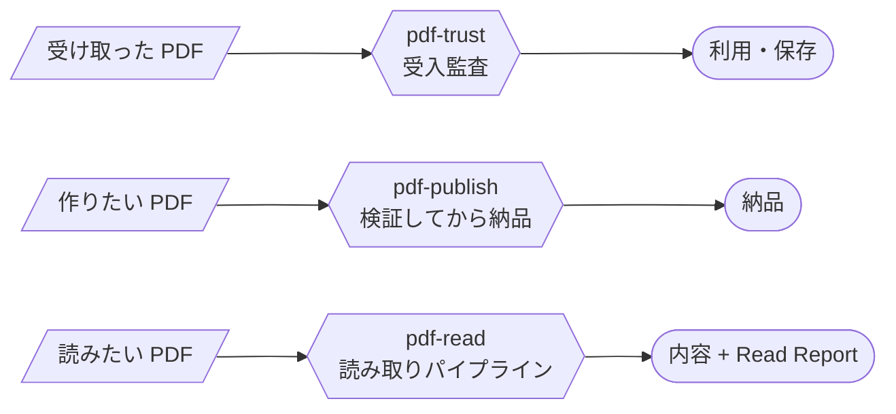

# Skill 一覧

MCP が「決定論的計算（同じ入力なら常に同じ結果になる計算）・暗号」を担うのに対し、Skill は「どの MCP をどの順に呼び、返ってきた結果をどう読むか」の手順と知識を担います。判定は `evaluate_policy` のコードが返し、LLM が書くのは説明の文章だけです。

| Skill | 役割 | 前提 MCP |
|---|---|---|
| [pdf-trust](/ja/skills/pdf-trust) | pdf-verify を軸に受入監査を行い Trust Report を返す | pdf-verify **必須**（v0.7.0+、**v0.29.0+ 推奨**） / reader・spec・houki 系は任意 |
| [pdf-publish](/ja/skills/pdf-publish) | write → read-back → verify の納品パイプライン | pdf-writer / pdf-reader / pdf-verify |
| [pdf-read](/ja/skills/pdf-read) | 大きな PDF・読めない PDF から必要な箇所を取り出し、読めなかった箇所を Read Report に書く | pdf-reader **必須** (v0.15.1+ 推奨) / spec は任意 |
