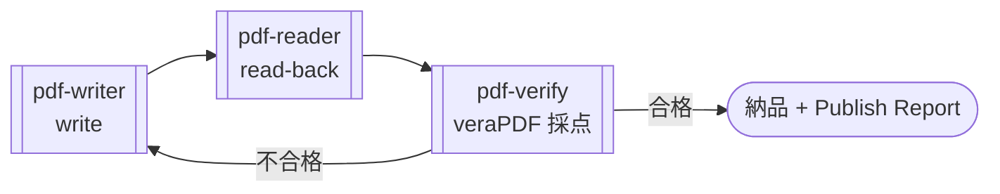

# pdf-publish — 納品パイプライン

PDF の生成・編集から納品までを、品質ゲートを通して行う Skill です。pdf-writer で書き、pdf-reader で読み戻し、pdf-verify（veraPDF）で機械採点する **write → read-back → verify ループ**を回し、**Publish Report** 付きで納品します。



## 対応シナリオ

- PDF/UA 準拠（タグ付き）PDF の生成（PDF 1.7 では PDF/UA-1、PDF 2.0 では PDF/UA-2）
- 請求書とデータの同梱: PDF/A-3b + 添付ファイル（`attach_file`）。PDF/A-4 を求められた場合は **`pdfa-4f`**（素の `pdfa-4` は添付自身が PDF/A であることを要求するため、CSV/XML の同梱と両立しません）
  - 「電帳法対応の PDF」と頼まれたときは、PDF/A も添付も電帳法の要件ではないことを伝え、何を求めているか（PDF/A で残したいのか、データを同梱したいのか）を確かめてから水準を決めます。電子取引のデータの保存で電帳法が求めるのは、タイムスタンプ・訂正削除の記録か防止ができるシステム・事務処理規程のいずれかの措置です（電子帳簿保存法施行規則 4 条 1 項）。Publish Report に「電帳法に対応した」とは書きません
- フォームの PDF/UA 化（`tag_form_fields`）
- 品質保証付き一般納品

## 品質ゲート水準

どこまで確認してから納品するかを 3 水準から選びます。この Skill の中心的な設定です。

| 水準 | 内容 | 必須 MCP |
|---|---|---|
| `none` | 生成のみ。ゲートなし（下書き・使い捨て向け） | writer |
| `readback` | reader で読み戻し、意図どおり出力されたかを観測するまで | writer + reader |
| `conformance(flavour)` | veraPDF の採点で COMPLIANT になるまで。flavour は測る規格（`pdfa-3b` / `pdfa-4` / `pdfa-4f` / `pdfua-1` / `pdfua-2`） | writer + verify（veraPDF 推奨） |

## 要点

- ラベル（`ensure_pdfa` / `ensure_tagged`）を書いたら必ず対応する flavour で `validate_conformance` を実行します — **測れないならラベルを書きません**
- 判定は veraPDF のものです。「veraPDF が COMPLIANT と判定」と報告し「ISO 19005 準拠」とは書きません
- **測る flavour は、最後に書いた writer の結果の `output.declares` から決めます**（writer 0.28.0 から）。頼まれた内容からは決めません。宣言されているものはすべて測ります。`pdfua: 1` なら `pdfua-1`、`pdfua: 2` なら `pdfua-2`、`pdfa: "3b"` / `"4"` / `"4f"` なら対応する `pdfa-*` です。`declares` はファイルの自己申告で、合否は `validate_conformance` で決まります

## 組み合わせられる規格

PDF/UA-1 は PDF 1.0〜1.7 を基盤とし（ISO 14289-1 §6.1）、PDF/UA-2 は PDF 2.0 を基盤とします（ISO 14289-2 §6.1）。PDF/A-3 は PDF 1.x のヘッダを、PDF/A-4 は 2.0 を要求するので、アクセシビリティの規格が PDF/A の規格を決めます。

| PDF の版 | アクセシビリティ | 長期保存 | 手順 | 実測（veraPDF 1.30.0） |
|---|---|---|---|---|
| 1.7 | PDF/UA-1（`pdfua-1`） | PDF/A-3b（`pdfa-3b`） | `create_*(tagged)` → `ensure_pdfa` | 106/106・146/146 |
| 2.0 | PDF/UA-2（`pdfua-2`） | PDF/A-4（`pdfa-4` / `pdfa-4f`） | `create_*(tagged, pdfVersion: "2.0")` → `ensure_pdfa(flavour: "pdfa-4")` | 1,728/1,728・109/109 |

これ以外の組み合わせは、writer が `INVALID_ARGUMENT` で断ります。`ensure_pdfa` が `next_actions[0].action: "retry_with_flavour"` を返したら、Skill は従う前に `example.flavour` を読みます。`pdfa-3b` なら入力が PDF/UA-1 を宣言している、`pdfa-4` なら入力が PDF 2.0 である、という意味です。目標の規格を黙って変えることはせず、変えるかどうかは利用者に確かめます。アクセシビリティと PDF/A-4 の両方を求められたら、新しく作る文書は PDF 2.0 で作ります。既存の PDF/UA-1 文書なら、「PDF/A-3b + PDF/UA-1」にするか、PDF 2.0 で作り直すかを利用者に選んでもらいます。

`merge_pdfs` は、PDF 2.0 と PDF 1.x が混ざった入力を、`pdfVersion` が無ければ断ります。`pdfVersion: "2.0"` は明示的な変換なので、PDF/A-3b を目標にしている案件では、使う前に利用者に確かめます。

## 実測例 — Publish Report 要旨（2026-08-11）

請求書デモ（日本語・タグ付き・CSV 添付）を水準 `conformance(pdfa-3b + pdfua-1)` で納品した実走記録:

| Phase | 実施内容 | 結果 |
|---|---|---|
| 1 生成 | `create_markdown_pdf`（tagged, lang: ja）→ `attach_file`（CSV, **Data**）→ `ensure_pdfa`（**必ず最後**） | 初回 `FONT_REQUIRED` で失敗 → 構造化エラーの `next_actions` に従い fontPath 指定で復帰 |
| 2 読み戻し | read_text / extract_structured_text / inspect_fonts / inspect_tags / inspect_structure | 識別子・数値すべて残存。H1 は 1 つ。フォント埋め込み + サブセット。catalog に **Names / AF / OutputIntents** 実在 |
| 3 品質ゲート | identify_conformance + validate_conformance ×2 | **veraPDF が PDF/A-3b COMPLIANT（146/146）・PDF/UA-1 COMPLIANT（106/106）と判定** |
| 4 修正ループ | — | **0 回**（初回通過） |

`ensure_pdfa` は成功時にも必ず warning を返します:

> This file now **CLAIMS** PDF/A-3b …, but conformance was **NOT checked** here. … Verify before
> relying on it: pdf-verify-mcp validate_conformance(flavour: "pdfa-3b")

これは異常ではなく設計です。ラベルを書いた瞬間に検証が省略不能になります —
この warning を Report に転記し、対応する flavour を測ってから納品します。

### 2 つ目の実測例 — PDF/UA-2 + PDF/A-4（2026-11-10）

pdf-publish 0.8.0 と writer 0.28.1 で、`create_markdown_pdf(tagged, pdfVersion: "2.0", lang: "ja", drawTitle: false)` → `add_bookmarks` → `ensure_pdfa(flavour: "pdfa-4")` の順に実行しました。`output.declares` は `{pdfua: 2}` → `{pdfua: 2}` → `{pdfua: 2, pdfa: "4"}` と変わり、Skill はここから `pdfua-2` と `pdfa-4` を測りました。`identify_conformance` の自己申告とも一致しています。**veraPDF 1.30.0 は PDF/UA-2 を COMPLIANT（1,728/1,728）、PDF/A-4 を COMPLIANT（109/109）と判定**し、修正ループは 0 回でした。

## ループ打ち切り条件

- 修正ループは**上限 3 回**です。超えたら停止し、残違反リスト + 条文根拠（pdf-spec があれば）を添えて人手レビューへ引き渡します
- **同じ違反が 2 回続いたら即座に人手へ** — その修正は効いていません
- 前段が失敗したら後段は「失敗」ではなく「**スキップ**」と記録します（原因の誤読を防ぐためです）
- native エンジンでの `compliant: null` は「検査サブセットで違反なし」であって適合ではありません — conformance 水準の判定は保留し、veraPDF の導入を提案します

## インストール

```sh
/plugin marketplace add shuji-bonji/claude-plugins
/plugin install pdf-writer-mcp@shuji-bonji   # 必須基盤
/plugin install pdf-verify-mcp@shuji-bonji   # conformance 水準では必須
/plugin install pdf-publish@shuji-bonji
# 推奨: pdf-reader-mcp（読み戻し）
```

リポジトリ: [shuji-bonji/pdf-publish-skill](https://github.com/shuji-bonji/pdf-publish-skill)（SKILL.md 本体・エラーコード対応表）

## ツールが足りないときの動き（縮退動作）

- pdf-writer 未接続 → 成立しません。接続を案内して停止します
- pdf-verify 未接続 → `conformance` 水準は**中止**します（`readback` に下げる合意が取れれば続行）。`ensure_pdfa` / `ensure_tagged` を使う案件は水準にかかわらず verify 必須です — 検査できないならラベルも書きません
- pdf-reader 未接続 → 読み戻しを「未実施（ツール未接続）」と明記し、できる範囲で続行します
- 標準フォントで書けない字（日本語など）を含むのに埋め込みフォントが無い → `FONT_REQUIRED`（構造化エラー。原因の字は `detail.characters` に入ります）。`fontPath` か環境変数 `PDF_WRITER_FONT` で解決します。writer 0.26.0 から、`“` `—` `€` などの WinAnsiEncoding の字は標準フォントで描けます
