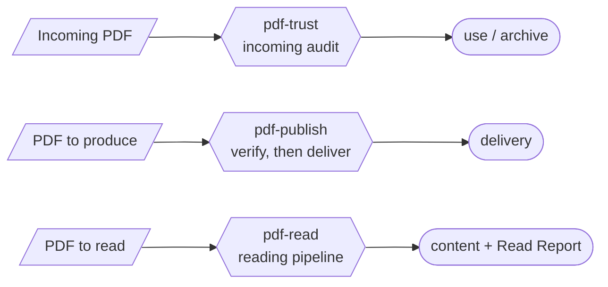

# Skills

Where the MCPs own deterministic computation and cryptography, the Skills own the procedure and knowledge: which MCP to call in which order, and how to read what comes back. The verdict is returned by `evaluate_policy`'s code; the LLM writes only the explanation.

| Skill | Role | Required MCPs |
|---|---|---|
| [pdf-trust](/skills/pdf-trust) | Orchestrates the incoming audit and returns a Trust Report | pdf-verify **required** (v0.7.0+, **v0.29.0+ recommended**) / reader, spec and houki-* optional |
| [pdf-publish](/skills/pdf-publish) | The write → read-back → verify delivery pipeline | pdf-writer / pdf-reader / pdf-verify |
| [pdf-read](/skills/pdf-read) | Pulls what you need out of large or unreadable PDFs, and reports what could not be read | pdf-reader **required** (v0.15.1+ recommended) / spec optional |
